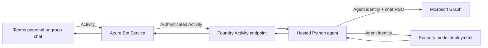

# Foundry Teams Chat Agent POC architecture

This document describes the architecture of a Microsoft Foundry hosted agent
that answers questions in Microsoft Teams using recent group-chat messages as
context. It explains the components, request flow, identity and authorization
model, security boundaries, design decisions, limitations, and the evidence
required to show that the design works in a live tenant.

## 1. Purpose and scope

The POC shows that a Foundry hosted agent can:

- Receive Teams messages through Azure Bot Service and the Foundry Activity
  Protocol endpoint.
- Read recent messages from a group chat using **its own Entra agent identity**
  and chat-scoped Teams resource-specific consent (RSC).
- Answer with a Foundry model deployment using the same identity.
- Do all of the above without a Graph app registration, client secret,
  certificate, or tenant-wide chat permission in the container.

| In scope | Out of scope |
|---|---|
| Personal chat (model only) | Team/channel messages |
| Group chat when the bot is @mentioned | File uploads and Copilot extensibility |
| Bounded recent chat history (default 10, max 50 messages) | Delegated user sign-in |
| Restricted invocation through `BotServiceRbac` | Durable application-managed memory |
| | Calling Graph as a separate application |

## 2. Architecture overview



| Component | Responsibility | Defined in |
|---|---|---|
| Foundry account and project | Hosts the agent and model; local (key) auth disabled | [infra/main.bicep](../infra/main.bicep) |
| Model deployment (`gpt-4.1-mini`) | Generates answers through the Responses API | [infra/main.bicep](../infra/main.bicep) |
| Hosted agent | Activity handler, Graph history reader, model gateway | [main.py](../src/foundry-teams-chat-agent/main.py), [azure.yaml](../azure.yaml) |
| Agent identity | Platform-provisioned Entra identity used for bot, Graph, and model calls | Created by Foundry at deployment |
| Azure Bot and Teams channel | Routes Teams activities to the Foundry endpoint | Created by `azd deploy` |
| Teams app package | Binds the bot identity and declares `ChatMessage.Read.Chat` RSC | [build-teams-package.py](../scripts/build-teams-package.py), post-deploy hooks |

The Foundry account and project managed identities serve platform
infrastructure; they are not the container's agent identity.

## 3. Request flow

1. A user sends a message in Teams. Azure Bot Service authenticates it and
   forwards it to the agent's stable Foundry endpoint:

   ```text
   https://<account>.services.ai.azure.com/api/projects/<project>/agents/foundry-teams-chat-agent/endpoint/protocols/activityProtocol
   ```

2. Foundry enforces `BotServiceRbac` and delivers the activity to the
   container at `POST /activity/messages`.
3. The handler routes by conversation type:

   | Conversation | Behavior |
   |---|---|
   | Channel | Ignored (unsupported). |
   | Group chat, bot not mentioned | Ignored: no Graph or model call. |
   | Group chat, bot mentioned | Reads recent chat history from Graph, then calls the model. |
   | Personal | Calls the model without chat history. |

4. For group chats, the Teams conversation ID is used as the Graph chat ID for
   `GET /chats/{chat-id}/messages`. The agent never accepts a user-supplied
   chat ID. Messages are converted from HTML to text with sender labels.
5. The model receives the history, explicitly marked as untrusted content, and
   the user's request. The answer is returned to Teams.
6. Graph, model, or validation failures are logged without tokens and produce a
   generic failure reply.

## 4. Identity and authorization model

A single principal — the hosted agent identity — is used for every hop:

| Hop | Mechanism | Authorization control |
|---|---|---|
| Teams → Bot → Foundry | Bot channel authentication | `BotServiceRbac`; callers need **Foundry Agent Consumer** at agent or project scope |
| Agent → Microsoft Graph | `DefaultAzureCredential` requests `https://graph.microsoft.com/.default` as the agent identity | `ChatMessage.Read.Chat` application RSC, consented per group chat |
| Agent → Foundry model | Same credential through `AIProjectClient` | Foundry data-plane RBAC |

Teams package binding:

- `bots[].botId` and `webApplicationInfo.id` both use the agent's
  application/client ID. Matching them is a deliberate single-principal choice.
- The manifest `id` is the Teams app (title) ID generated by Microsoft 365 and
  is a different identifier; it is preserved unchanged.
- `authorization.permissions.resourceSpecific` declares only
  `ChatMessage.Read.Chat` with type `Application`.
- `webApplicationInfo.resource` must be nonempty but has no operational
  meaning for RSC; the generated value is preserved.

RSC is granted when the app is installed or upgraded **in a group chat** and a
member consents. Uploading the package or installing it personally does not
grant chat-history access, and RSC is not a tenant-wide Graph app role.

Azure subscription Contributor/Owner alone does not grant Foundry data-plane
access. Teams custom-app upload and RSC consent policies are separate tenant
controls.

## 5. Security considerations

- **No stored credentials.** The container has no Graph client secret or
  certificate. `DefaultAzureCredential` is a credential chain, so verify the
  deployed token's application identity rather than assuming it.
- **Least privilege.** Chat access is limited to consenting group chats, a
  bounded message window, and read-only chat messages.
- **Restricted invocation.** `BotServiceRbac` limits callers to assigned
  testers. `BotServiceTenant` would broaden access to the whole tenant and is
  not enabled.
- **Prompt injection.** Chat history is passed as delimited, untrusted data.
  This is a mitigation, not a guarantee; use synthetic chat data for demos.
- **Logging.** Tokens are kept out of logs and model input. Logs include the
  model name, channel, and conversation ID.
- **Reduced package capabilities.** The generated package is limited to
  personal and group-chat scopes; team, Copilot, channel, and file features
  are removed because the handler does not implement them.

## 6. Design decisions

### Use the agent identity directly for Graph

[Entra supports Teams RSC for agents][m365-rsc], [Teams RSC][rsc] lists
`ChatMessage.Read.Chat` as an application chat permission, and
[list chat messages][graph-messages] accepts it as the least-privileged
application permission. This removes the need for a separate app, secret, or
token broker.

The [hosted-agent runtime][hosted] exposes the agent identity to the
container, so `DefaultAzureCredential` can request Graph tokens without
configuration.

### Do not federate the agent identity into a separate app registration

The documented [workload identity federation scenarios][wif] do not include an
Entra agent identity acting as a federated credential for an unrelated app
registration. The [autonomous Agent ID flow][autonomous] documents
blueprint-to-child-agent exchange, not child-agent-to-separate-app exchange.
Creating a federated credential or obtaining a token for
`api://AzureADTokenExchange` does not prove that such an exchange is supported.

If Graph calls must be made by a separate application, use that application's
documented authentication. One secretless option is a
[user-assigned managed identity federated to the app][mi-fic], attached to
compute that can use it, with `ClientAssertionCredential`. This requires
infrastructure outside the hosted agent and is not part of this POC. A
certificate avoids a secret environment variable but still requires private
key management.

### Keep the Activity Protocol only

The [Foundry agent endpoint][endpoint] can enable several protocols. This
sample implements only Activity, so it advertises only Activity. Endpoint
collection updates replace existing entries; retain any protocols and
authorization schemes you want to keep.

This Activity-only implementation is intentionally limited to the POC. Current
Foundry guidance recommends Responses plus Activity for agents published to
Teams so that Responses supplies the conversation semantics and the platform
bridges channel delivery through Activity. Evaluate that migration before
production use; it is not required to prove this POC's direct Activity handler.

## 7. Deployment

- `azd provision` creates the Foundry account, project, and model deployment.
- `azd deploy` creates the hosted agent, its identity, and the Azure Bot with
  Teams channel.
- The post-deploy hook resolves the bot application ID, runs
  `azd ai agent pack`, restricts its capabilities, adds the RSC declaration,
  and writes `foundry-teams-chat-agent-poc.zip`.

See the [README](../README.md) for commands and the
[Teams setup guide](TEAMS_APP_SETUP.md) for installation and consent.

## 8. Limitations

- Offline tests mock identity, Graph, and Teams; they cannot prove consent or
  authorization.
- Local runs use developer credentials, not the agent identity's RSC access.
- RSC and identity changes may require reinstalling or upgrading the Teams app,
  and permission propagation may be delayed.
- Hosted deployment uses Python 3.13; validate it in the deployed runtime.
- Chat history is read for each request; nothing is persisted.

## 9. Live acceptance criteria

Record these results before describing the POC as demonstrated end to end:

1. The active agent version's bot uses the agent application ID, and an
   authorized tester can invoke it from Teams.
2. No Graph client secret or certificate is configured in the container.
3. A Graph token requested in the hosted runtime has an `azp` or `appid`
   matching `webApplicationInfo.id`. Inspect only selected claims (`tid`,
   `aud`, `azp`/`appid`, `oid`); never print or share the token. A `roles`
   claim alone does not prove the chat-scoped grant.
4. In a consenting group chat, mentioning the bot about an earlier message
   produces an answer based on that message.
5. An unmentioned group-chat message produces no response and no Graph or model
   call.
6. The same identity is denied access to a second chat without the grant
   (operator test; do not add a chat-ID input to the bot).
7. After the app is removed, chat access is denied once changes propagate.
8. An unauthorized caller is rejected by RBAC, and a personal message does not
   request chat history.

## References

[wif]: https://learn.microsoft.com/entra/workload-id/workload-identity-federation
[mi-fic]: https://learn.microsoft.com/entra/workload-id/workload-identity-federation-config-app-trust-managed-identity
[autonomous]: https://learn.microsoft.com/entra/agent-id/autonomous-agent-authentication-authorization-flow
[hosted]: https://learn.microsoft.com/azure/foundry/agents/concepts/hosted-agents#agent-identity-and-endpoint
[m365-rsc]: https://learn.microsoft.com/entra/agent-id/grant-agent-access-microsoft-365#teams-resource-specific-consent-rsc
[rsc]: https://learn.microsoft.com/microsoftteams/platform/graph-api/rsc/resource-specific-consent
[grant-rsc]: https://learn.microsoft.com/microsoftteams/platform/graph-api/rsc/grant-resource-specific-consent
[graph-messages]: https://learn.microsoft.com/graph/api/chat-list-messages?view=graph-rest-1.0
[endpoint]: https://learn.microsoft.com/azure/foundry/agents/how-to/configure-agent

- [Workload identity federation][wif]
- [Managed identity federated to an app][mi-fic]
- [Autonomous agent authentication flow][autonomous]
- [Hosted agent identity and endpoint][hosted]
- [Grant agents access to Microsoft 365 (Teams RSC)][m365-rsc]
- [Teams resource-specific consent][rsc]
- [Configure RSC in the Teams manifest][grant-rsc]
- [List chat messages (Graph)][graph-messages]
- [Configure a Foundry agent endpoint][endpoint]
