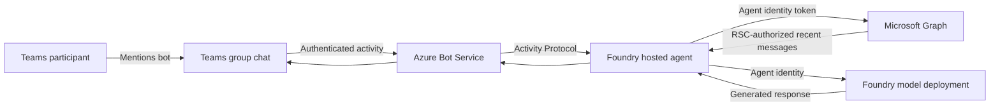

# Microsoft Foundry Agent for Teams POC Requirements

## 1. Purpose

This proof of concept demonstrates that a Microsoft Foundry hosted agent can
participate in Microsoft Teams group chats, use recent chat messages as model
context, and authenticate to Microsoft Graph without storing a client secret in
the hosted container.

The POC is intended to answer the following architectural question:

> Can a Foundry hosted agent use its dedicated Microsoft Entra agent identity
> as the Teams bot identity and Microsoft Graph caller for the
> `ChatMessage.Read.Chat` resource-specific consent permission?

This document describes the intended behavior and proposed architecture. The
current application source is not the authority for these requirements because
it may contain temporary experiments.

Passing local tests or generating a package is not evidence that live Teams
consent and Graph authorization succeed. Complete the
[live acceptance criteria](architecture.md#9-live-acceptance-criteria)
before claiming the POC is demonstrated. The
[architecture document](architecture.md#6-design-decisions) explains why
federation into a separate app is not the chosen design.

## 2. Goals

The POC must demonstrate that:

1. A code-based agent can run as a Microsoft Foundry hosted agent.
2. Users can interact with the agent from Microsoft Teams through the Activity
   Protocol and Azure Bot Service.
3. The agent can retrieve recent messages from the group chat in which it is
   installed.
4. Access to chat messages is limited to chats that grant
   `ChatMessage.Read.Chat` through Teams resource-specific consent (RSC).
5. The hosted agent can call Microsoft Graph as its own dedicated Entra agent
   identity.
6. No application client secret is stored in the hosted agent's code,
   configuration, or container environment.
7. The agent can use the retrieved chat history as contextual input to a model
   deployed in Microsoft Foundry.
8. The sample clearly separates authentication, authorization, Teams message
   delivery, Graph data access, and model invocation.

## 3. Non-goals

The POC is not intended to provide:

- A production-ready application.
- Tenant-wide access to Teams chats or messages.
- Access to chats where the Teams app is not installed.
- Automatic responses to every message in a group chat.
- Delegated Microsoft Graph access on behalf of a signed-in user.
- Federation from the hosted agent identity into a separate app registration.
- Client-secret, certificate, or API-key authentication for Microsoft Graph.
- Persistent conversation memory outside the selected recent chat history.
- Production data retention, audit, compliance, or legal-hold controls.
- A complete approval workflow or permission-management user interface.
- Broad Microsoft 365 access beyond the required Teams chat scenario.

## 4. Primary user scenario

1. A Teams user installs the application in a group chat.
2. During installation or upgrade, the user reviews and grants the
   `ChatMessage.Read.Chat` application RSC permission for that chat.
3. A participant mentions the bot and asks a question.
4. Teams sends the activity to Azure Bot Service.
5. Azure Bot Service forwards the authenticated activity to the Foundry hosted
   agent's Activity Protocol endpoint.
6. The agent obtains a Microsoft Graph token as its dedicated Entra agent
   identity.
7. The agent requests a limited number of recent messages from the current
   group chat.
8. Microsoft Graph authorizes the request using the RSC grant for that specific
   chat.
9. The agent supplies the recent messages and current question to the Foundry
   model.
10. The agent sends the model's response back to the same Teams conversation.

## 5. Identity and authorization requirements

### 5.1 Hosted agent identity

- The Foundry deployment must create or assign a dedicated Microsoft Entra
  agent identity to the hosted agent.
- The hosted container must authenticate as that identity using the identity
  capability supplied by the Foundry runtime.
- The application must use an Azure SDK `TokenCredential` implementation to
  request resource-specific access tokens.
- Production authentication must not depend on Azure CLI, Visual Studio Code,
  or an interactive developer identity.

### 5.2 Single-principal design

The same application/client ID must identify:

- The Foundry hosted agent's Teams bot.
- The bot declared in the Teams application package.
- The application declared by `webApplicationInfo.id`.
- The principal receiving the Teams RSC grant.
- The identity presented to Microsoft Graph at runtime.

The package-generation process must keep these identity values aligned.
This alignment is a POC design choice, not a requirement for all Teams apps.
The Microsoft 365-generated manifest `id` is a separate Teams title ID and must
not be replaced with the bot/client ID. Service-principal object IDs and token
subject claims must not be assumed to equal application/client IDs.

### 5.3 Microsoft Graph authentication

- The agent must request a token for
  `https://graph.microsoft.com/.default`.
- The resulting token must represent the hosted agent identity.
- The implementation must not authenticate to Microsoft Graph as a separate
  app registration.
- The implementation must not require a client secret, certificate, or
  manually supplied access token.
- A custom runtime outside Foundry is out of scope and may require the Microsoft
  Entra Agent ID SDK, sidecar, or explicit blueprint token exchange.

### 5.4 Teams resource-specific consent

- The Teams application package must declare
  `ChatMessage.Read.Chat` with type `Application`.
- The package must include:
  - A bot declaration for the group-chat scope.
  - `webApplicationInfo.id` set to the bot/agent application ID.
  - A nonempty `webApplicationInfo.resource`. The field has no operational
    meaning for RSC; retain the value generated by Microsoft 365.
- Permission must be granted when the application is installed or upgraded in
  a group chat.
- Authorization must remain scoped to the chat where consent was granted.
- The POC must not request tenant-wide `Chat.Read.All` or
  `Chat.ReadWrite.All` solely to support this scenario.

## 6. Functional requirements

### FR-1: Receive Teams activities

The hosted agent must expose an Activity Protocol endpoint that can receive
authenticated message activities forwarded by Azure Bot Service.

### FR-2: Support personal and group-chat installation

The Teams application may support personal and group-chat scopes. Graph chat
history retrieval is required only for supported group-chat scenarios.

### FR-3: Require deliberate invocation

Because `ChatMessage.Read.Chat` can cause Teams to deliver group-chat messages
that do not mention the bot, the agent must ignore unmentioned group-chat
messages unless a future requirement explicitly enables proactive behavior.

### FR-4: Identify the current chat

The agent must obtain the current chat identifier from the authenticated Teams
activity. It must not accept an arbitrary user-supplied chat ID for Graph
access.

### FR-5: Read recent chat history

- The agent must call `GET /chats/{chat-id}/messages`.
- The number of messages retrieved must be bounded and configurable.
- The configured value must not exceed the Microsoft Graph API limit.
- The agent must use only the history required for the current response.
- Failure to retrieve required history must be surfaced as an error rather than
  silently represented as successful retrieval.

### FR-6: Normalize retrieved messages

- Message bodies must be converted from Teams HTML content to plain text before
  being sent to the model.
- Empty messages must be omitted.
- Sender attribution should be retained when available.
- Access tokens and authorization headers must never be included in model
  input or application logs.

### FR-7: Invoke the Foundry model

- The agent must call the model deployment through the Foundry project
  endpoint.
- Model access must use the hosted workload identity rather than an API key.
- The current request and recent chat history must be clearly separated in the
  model input.
- Retrieved chat history must be treated as untrusted content, not as trusted
  system instructions.

### FR-8: Return the response to Teams

The agent must return a text response through the same Activity Protocol
conversation from which the request originated.

### FR-9: Handle failures explicitly

- Authentication, authorization, Graph, and model failures must be logged
  server-side without exposing credentials or internal exception details to
  users.
- Users must receive a clear failure message.
- A missing RSC grant must not be presented as an empty but successful chat
  history result.

## 7. Infrastructure and deployment requirements

The POC must provision or configure:

- A Microsoft Foundry account and project.
- A supported model deployment.
- A code-based Foundry hosted agent.
- A dedicated Entra agent identity for the hosted agent.
- An Activity Protocol endpoint.
- An Azure Bot registration connected to Microsoft Teams.
- A Teams application package containing the bot and RSC declarations.

Deployment automation must:

- Discover the provisioned bot/agent application ID.
- Insert that ID into all required Teams manifest identity fields.
- Fail when the required bot identity cannot be resolved.
- Avoid generating or storing a Graph client secret.

## 8. Security requirements

- Use least-privilege, chat-scoped RSC instead of tenant-wide Graph
  application permissions.
- Do not store credentials in source control, environment variables, container
  images, or Teams packages.
- Do not log access tokens, authorization headers, or raw identity assertions.
- Treat Teams messages and Graph content as untrusted input.
- Treat retrieved message content as data rather than trusted instructions.
  The POC's model instruction is not a prompt-injection security boundary.
- Validate that the activity represents the current conversation before using
  its chat identifier.
- Return generic user-facing errors while retaining actionable server-side
  diagnostics.
- Limit the quantity of chat history sent to the model.
- Document that installing the application grants access to messages in the
  selected group chat.

## 9. What was built

The following describes the implemented design, not verified live-tenant
outcomes. The acceptance criteria in section 11 remain mandatory.

The POC architecture consists of:

1. **Microsoft Teams application package**
   - Declares personal and group-chat bot scopes.
   - Requests `ChatMessage.Read.Chat` application RSC.
   - Uses one application ID for the bot and RSC principal.
   - Preserves the separate Microsoft 365-generated Teams title ID.

2. **Azure Bot and Teams channel**
   - Receives Teams activities.
   - Forwards signed activities to the hosted agent's stable Activity Protocol
     endpoint.

3. **Foundry hosted agent**
   - Runs custom Python application logic.
   - Receives Activity Protocol messages.
   - Uses its dedicated Entra agent identity at runtime.
   - Ignores group-chat messages that do not mention the bot.

4. **Microsoft Graph integration**
   - Obtains an application token as the hosted agent identity.
   - Reads a bounded set of messages from the current group chat.
   - Relies on the chat-specific RSC grant for authorization.

5. **Foundry model integration**
   - Calls the configured model through the Foundry project endpoint.
   - Supplies recent chat history and the current request as model input.
   - Treats retrieved history as untrusted context.

6. **Deployment automation**
   - Provisions the Foundry and bot resources.
   - Resolves the bot/agent application ID after deployment.
   - Uses Microsoft 365 packaging and preserves its title/identity binding.
   - Restricts capabilities to personal and group chat with message-read RSC.

7. **Documentation and tests**
   - Documents installation and RSC consent.
   - Tests identity-independent message normalization, configuration, mention
     filtering, Graph request construction, and manifest generation.

## 10. Architecture summary



The authorization boundary is:

```text
Hosted agent identity
        +
ChatMessage.Read.Chat RSC grant
        +
Current installed group chat
        =
Permission to read that chat's messages
```

## 11. Acceptance criteria

The POC is successful when all of the following are demonstrated:

1. The application can be installed in a Teams group chat.
2. Installation or upgrade presents the `ChatMessage.Read.Chat` permission.
3. A mention of the bot reaches the Foundry hosted agent.
4. The agent obtains a Graph token without a configured client secret.
5. The Graph token represents the hosted agent identity.
6. The agent can read recent messages from the consenting group chat.
7. The same identity cannot read a chat where the app lacks an RSC grant.
8. An unmentioned group-chat message does not produce a bot response.
9. The model receives bounded, normalized chat context and the current request.
10. The model response is returned to the originating Teams conversation.
11. Removing or revoking the app's chat access causes the Graph request to fail
    rather than retain unauthorized access.
12. Logs and model input contain no access token or client secret.

## 12. Known constraints

- `ChatMessage.Read.Chat` is an application-context, chat-scoped permission.
- Consent must be granted for each group chat through app installation or
  upgrade.
- Personal-scope chat history has different RSC limitations and is not the
  target of this POC.
- Local developer credentials do not reproduce the deployed hosted agent's RSC
  authorization. End-to-end Graph validation must run in the deployed hosted
  agent.
- Identity and RSC changes may require reinstalling or upgrading the Teams app.
- Permission propagation may not be instantaneous.
- Tester Foundry RBAC, Teams upload policy, and chat RSC consent are separate
  prerequisites. The POC retains `BotServiceRbac` for restricted invocation.
- Federating the agent identity into a separate app registration is not a
  documented supported Agent ID flow and is not exercised by this demo.

## 13. Future production work

Before production use, the solution would require:

- Threat modeling and formal security review.
- Tenant policy and consent governance.
- Data classification, retention, and deletion policies.
- Prompt-injection and content-safety evaluation.
- Auditing and correlation across Teams, Graph, Foundry, and model calls.
- Rate limiting, retry policies, timeout policies, and circuit breaking.
- Monitoring and alerts for authorization failures and abnormal access.
- Accessibility and user-experience review.
- Load, scale, reliability, and disaster-recovery testing.
- A defined process for revoking chat access and validating removal.
- Evaluation of proactive behavior before processing unmentioned messages.

## 14. Reference documentation

- [Hosted agents in Foundry Agent Service](https://learn.microsoft.com/azure/foundry/agents/concepts/hosted-agents)
- [Authenticate and acquire tokens for autonomous agents](https://learn.microsoft.com/entra/agent-id/autonomous-agent-authentication-authorization-flow)
- [Grant agents access to Microsoft 365 resources](https://learn.microsoft.com/entra/agent-id/grant-agent-access-microsoft-365)
- [Resource-specific consent for Teams apps](https://learn.microsoft.com/microsoftteams/platform/graph-api/rsc/resource-specific-consent)
- [Configure an agent to receive all group-chat messages](https://learn.microsoft.com/microsoftteams/platform/agents-in-teams/enable-receive-all-chat-messages)
- [List messages in a chat](https://learn.microsoft.com/graph/api/chat-list-messages)
